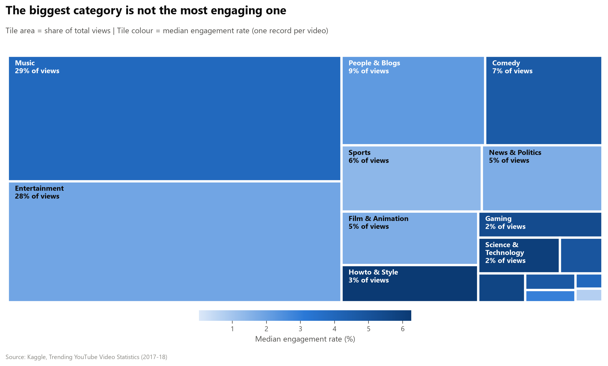
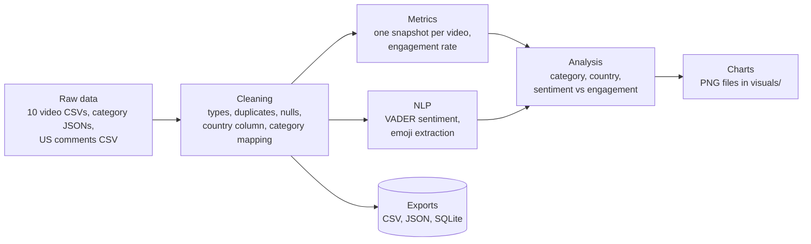
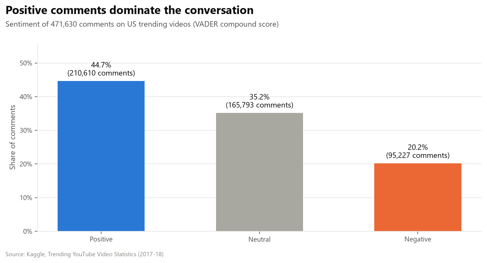
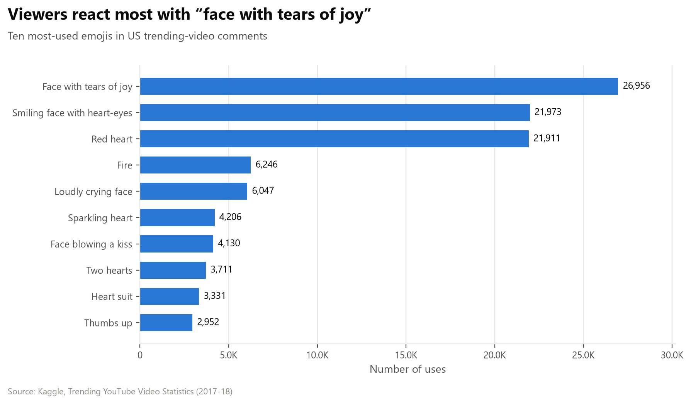
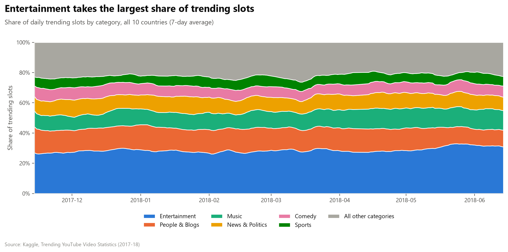
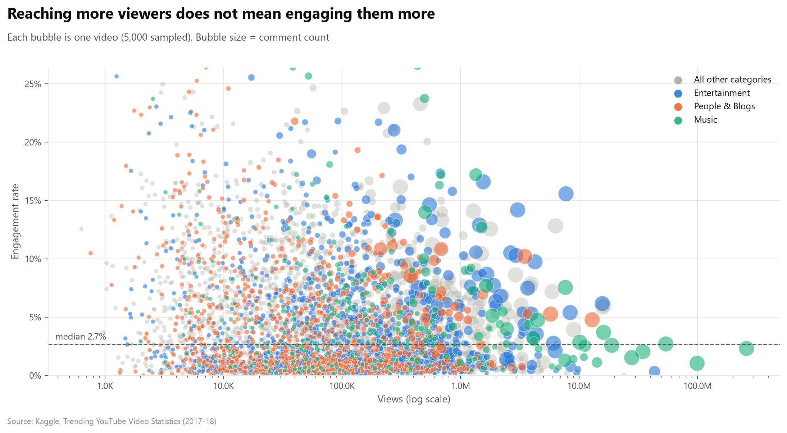
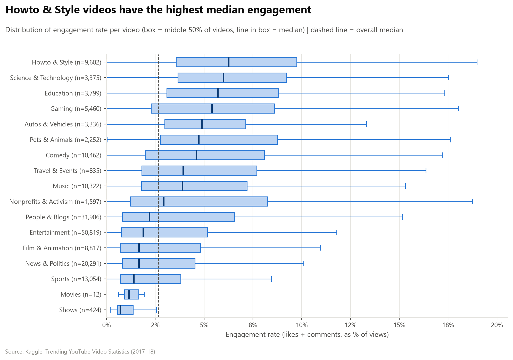
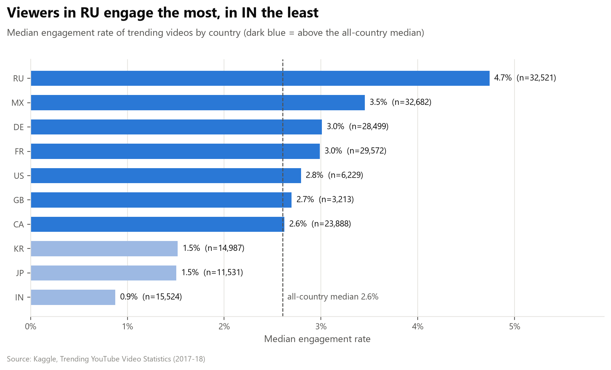
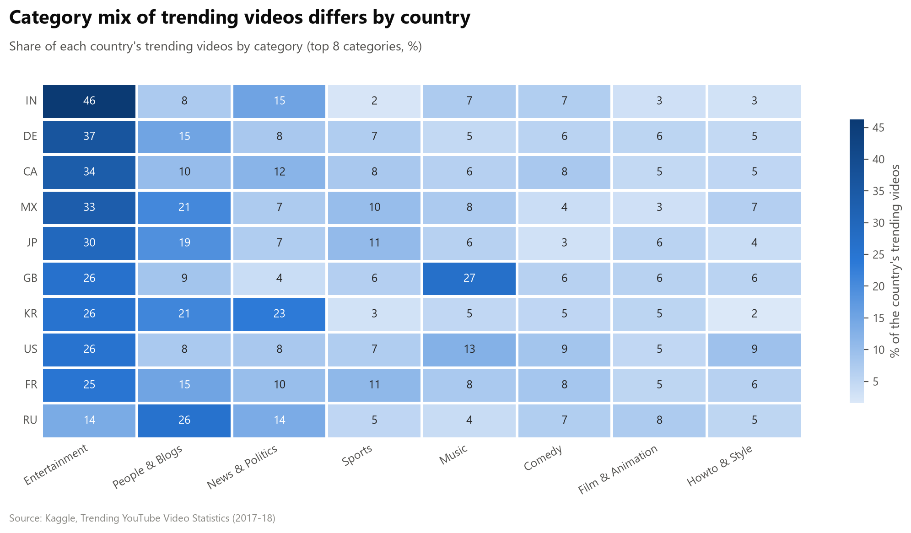

<div align="center">

# YouTube Trending Videos: Audience Sentiment, Engagement & Category Analysis

**An end-to-end data analytics project on 10 countries of YouTube trending data and US viewer comments**


</div>



## 📌 Executive Summary

**Business problem:** Content creators and marketing teams need to know what makes a video resonate. Reach (views) alone does not answer that, because a video can be widely watched and still leave viewers cold.

**What this project does:** It analyses YouTube's trending videos from **10 countries** and **user comments** on US trending videos. It measures how viewers feel (sentiment, emojis), which content categories earn attention versus engagement, and how countries differ.

**Decision it informs:** Where a brand should place content for *awareness* (reach) versus *interaction* (engagement), and whether one global content strategy is enough or local ones are needed.

**Target audience:** Marketing managers, content strategists and media agency analysts.

## 🎯 Business Questions

| # | Question | Method |
|---|----------|--------|
| 1 | How do viewers feel about trending videos, and how do they express it? | VADER sentiment analysis, emoji frequency analysis |
| 2 | Which categories capture the most attention, and which engage viewers best? | Engagement-rate metric, treemap, box plot |
| 3 | How do countries differ in engagement and in what trends? | Multi-country comparison, category-mix heatmap |
| 4 | Do videos with more positive comments also earn higher engagement? | Join of comments to videos, Spearman correlation |

## 🏗️ Data Architecture & Tech Stack

### Data provenance

| Item | Detail |
|------|--------|
| **Source** | Kaggle: [Trending YouTube Video Statistics](https://www.kaggle.com/datasets/datasnaek/youtube-new) |
| **Period** | Late 2017 to mid 2018 (daily trending lists) |
| **Videos** | One CSV per country: CA, DE, FR, GB, IN, JP, KR, MX, RU, US |
| **Comments** | `UScomments.csv`: a sample of comments on US trending videos |
| **Categories** | One `*_category_id.json` per country that maps `category_id` to a name |
| **Key columns** | `video_id`, `trending_date`, `category_id`, `views`, `likes`, `dislikes`, `comment_count`, `comments_disabled`, `ratings_disabled` |

### Pipeline



### Tech stack and why

| Tool | Why it was chosen |
|------|-------------------|
| **pandas, NumPy** | Fast, vectorised cleaning and aggregation for 300k+ rows |
| **NLTK VADER** | Built for short, informal social-media text and needs no training data |
| **emoji** | Detects complete emojis (flags, skin tones, multi-part emojis), not just single characters |
| **matplotlib, seaborn, squarify** | Static, consistent charts that render directly on GitHub and export as PNG |
| **SQLAlchemy + SQLite** | Shows the cleaned data can be stored in and queried from a database with SQL |
| **Jupyter Notebook** | Combines code, explanation and results in one readable document |

## 🔍 Key Insights

> The numbers below come from running the notebook on the full dataset.

### 1. Viewers are mostly positive, and they say it with emojis

- **[XX]%** of the US comments are positive, **[XX]%** neutral and **[XX]%** negative.
- The most-used emoji is **[emoji name]**, and laughter, love and approval symbols dominate the top 10.




### 2. Reach and engagement are two different things

- **[Category]** earns the largest share of views (**[XX]%**), but **[Category]** has the highest median engagement rate (**[XX]%**).
- The rank correlation between views and engagement rate is **[+/-0.XX]**, so more views do not mean more engagement.





### 3. Countries behave differently

- Median engagement ranges from **[XX]%** in **[country]** to **[XX]%** in **[country]**, a gap of about **[X.X]x**.
- **[Category]** is most prominent in **[country]** (**[XX]%** of its trending videos), while **[Category]** is most prominent in **[country]**.




### 4. Comment sentiment and engagement

- Comments are friendliest on **[Category]** videos.
- The Spearman correlation between a video's average comment sentiment and its engagement rate is **[+/-0.XX]**, which indicates **[little / a weak / a moderate]** relationship.


### Business recommendations

1. **Separate awareness goals from interaction goals.** Choose the category by what the campaign needs: reach or reaction.
2. **Localise content strategy.** Engagement and the content that trends differ by country.
3. **Use sentiment as a monitoring signal, not a performance predictor.** It helps spot negative reactions early, but it does not explain engagement on its own.

## 🚀 What Makes This Project Different

This project started from a guided course. The parts below are my own additions and are the ones I would discuss in an interview.

- **Per-video snapshots to avoid double-counting.** Views, likes and comments are running totals, so a video that trends for five days would be counted five times. I keep each video's highest-view day, so every metric comes from one moment.
- **Honest engagement metric.** Videos with ratings or comments switched off show zero likes or comments for reasons unrelated to the audience. I excluded them from engagement while keeping them in reach.
- **10-country comparison.** I added a `country` column when loading the files, which makes country-level engagement and category-mix analysis possible.
- **Sentiment joined to engagement.** I linked comment sentiment to video-level engagement, by category and as a correlation test.
- **Data-quality logging.** Every cleaning step reports how many rows it changed, and unmapped categories are flagged instead of silently dropped.
- **Reproducible and accessible.** Fixed random seeds, relative paths, a colour-blind-safe palette and charts saved automatically for this README.
- **Multi-format export.** A seeded sample is saved as CSV, JSON and a SQLite database, and read back with a SQL query.

## ⚙️ Setup & Reproducibility

> **The raw data is not stored in this repository** because of its size. Download it from Kaggle first.

**1. Clone the repository**

```bash
git clone https://github.com/ualiurrahat/youtube-data-analytics.git
cd youtube-data-analytics
```

**2. Create a virtual environment and install the dependencies**

```bash
python -m venv .venv
# Windows:
.venv\Scripts\activate
# macOS / Linux:
source .venv/bin/activate

python -m pip install -r requirements.txt
```

**3. Download the dataset**

Download [Trending YouTube Video Statistics](https://www.kaggle.com/datasets/datasnaek/youtube-new) from Kaggle and unzip it. Place the files like this (the 10 category JSON files are already in the repository):

```text
data/
└── raw/
    ├── UScomments.csv
    └── additional_data/
        ├── CAvideos.csv, DEvideos.csv, FRvideos.csv, GBvideos.csv, INvideos.csv,
        ├── JPvideos.csv, KRvideos.csv, MXvideos.csv, RUvideos.csv, USvideos.csv
        └── CA_category_id.json, ... , US_category_id.json
```

**4. Run the notebook**

Start Jupyter **from the project root folder**, open `youtube_data_analytics.ipynb` and choose **Kernel → Restart Kernel and Run All Cells**.

```bash
python -m notebook
```

**Outputs created by the run**

| Folder | Contents |
|--------|----------|
| `data/processed/` | `youtube_sample.csv`, `youtube_sample.json`, `youtube_sample.sqlite` (table `videos`) |
| `visuals/` | The 10 chart images used in this README |

## 🗂️ Repository Structure

```text
youtube-data-analytics/
├── youtube_data_analytics.ipynb   # the full analysis
├── requirements.txt               # Python dependencies
├── data/
│   ├── raw/                       # Kaggle files (not in the repo, see setup)
│   └── processed/                 # cleaned sample exports
├── visuals/                       # saved charts
├── LICENSE
└── README.md
```

## ⚠️ Limitations & Next Steps

**Limitations**

- **Trending videos only.** The findings describe videos that already trended, not YouTube as a whole.
- **A 2017-2018 snapshot.** Platform behaviour and audiences have changed since.
- **VADER reads English best.** Other languages, sarcasm and slang are often scored as neutral.
- **Comments are a US-only sample.** The sentiment results do not apply to the other nine countries.
- **Correlation is not causation.** No result here proves that one factor causes another.

**Next steps**

- Add sentiment analysis for the other countries with a multilingual model.
- Test whether title features (length, punctuation, keywords) relate to engagement.
- Turn the country comparison into an interactive Streamlit dashboard.

## 🙏 Acknowledgements

- **Dataset:** [Trending YouTube Video Statistics](https://www.kaggle.com/datasets/datasnaek/youtube-new) on Kaggle, collected from the YouTube API.
- **Course instructor:** Shan Singh, whose YouTube data analysis course guided the foundation steps (loading, cleaning, sentiment and emoji analysis). The data-quality fixes, engagement design, multi-country comparison, sentiment-vs-engagement analysis and chart design are my own extensions.

## 👤 Author

**Md. Ualiur Rahman Rahat**, aspiring data analyst based in Dhaka, Bangladesh.

[GitHub](https://github.com/ualiurrahat) | [LinkedIn](https://www.linkedin.com/in/YOUR-LINKEDIN-USERNAME)
